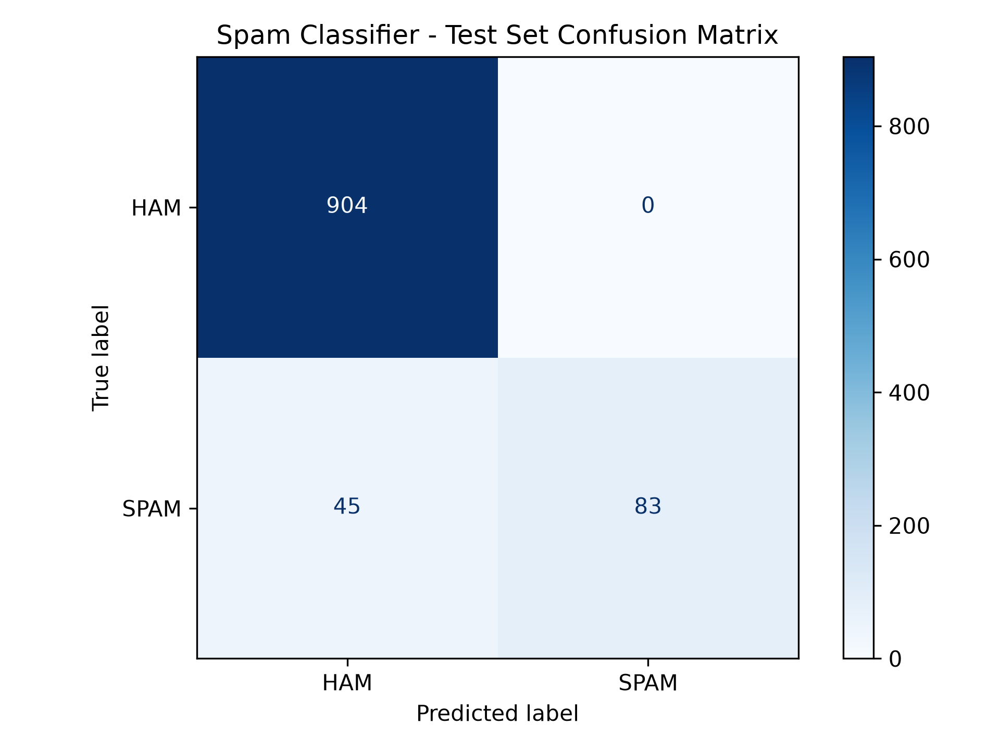

# CodeNova Task 2: Spam Message Classifier

## Project Overview

This project builds a machine-learning classifier that identifies SMS messages as **SPAM** or **HAM (not spam)**. It uses the SMS Spam Collection dataset and compares Multinomial Naive Bayes with Logistic Regression.

The model uses TF-IDF features and text preprocessing, including lowercasing, tokenization, and English stop-word removal.

## Features

- Text preprocessing: lowercase conversion, tokenization, and stop-word removal
- TF-IDF vectorization with unigram and bigram features
- Training and comparison of two machine-learning models
- Validation-based model selection
- Evaluation using precision, recall, F1-score, accuracy, and a confusion matrix
- Interactive custom-message predictions returning `SPAM` or `HAM`
- Saved, reusable model pipeline

## Dataset

**SMS Spam Collection** — a publicly available dataset of labeled SMS messages.

- `ham`: legitimate messages
- `spam`: unwanted or fraudulent messages
  
The dataset is stored locally in data/SMSSpamCollection and is excluded from this public repository. Download it from the official UCI source before running the project on another computer.

Dataset source: https://archive.ics.uci.edu/dataset/228/sms+spam+collection

The processed dataset used by this project contains 5,158 unique labeled messages after duplicate removal.

## Technology Stack

- Python
- pandas
- scikit-learn
- Matplotlib
- joblib

## Methodology

1. Load and validate the SMS dataset.
2. Remove duplicate messages with identical labels.
3. Split the data into training, validation, and test sets using stratified sampling.
4. Apply TF-IDF vectorization with custom tokenization and stop-word removal inside a scikit-learn pipeline.
5. Train Multinomial Naive Bayes and Logistic Regression on the training set.
6. Compare both models using validation-set spam precision, recall, F1-score, and accuracy.
7. Select the model using spam precision, with spam F1-score as the tie-breaker.
8. Evaluate the selected model on the separate test set.
9. Save the fitted pipeline and confusion matrix.

The TF-IDF vectorizer is fitted within the training pipeline, avoiding vocabulary leakage from validation and test messages.

## Test Results

The selected model was **Multinomial Naive Bayes**.

| Metric | Test result |
|---|---:|
| Accuracy | 95.64% |
| Spam precision | 100.00% |
| Spam recall | 64.84% |
| Spam F1-score | 78.67% |
```

### Confusion Matrix


```

These results are from one held-out test split and do not guarantee future performance. Although no legitimate messages were incorrectly flagged as spam in this test set, some spam messages were missed.

See `outputs/test_metrics.csv` and `outputs/confusion_matrix.png` for evaluation artifacts.

## Project Structure

```text
CodeNova-Task2-Spam-Classifier/
├── data/
│   └── SMSSpamCollection  # Download separately from UCI
├── src/
│   └── spam_classifier.py
├── outputs/
│   ├── confusion_matrix.png
│   ├── test_metrics.csv
│   ├── validation_model_comparison.csv
│   └── sample_predictions.txt
├── models/
│   └── best_spam_pipeline.joblib
├── requirements.txt
├── .gitignore
└── README.md
```

The raw dataset is not included in the public repository. Download it from the [official UCI SMS Spam Collection page](https://archive.ics.uci.edu/dataset/228/sms+spam+collection) and place the extracted `SMSSpamCollection` file in the `data/` folder before running the project.

## Setup Instructions

Python 3.10 or newer is recommended.

1. Clone or download this repository.
2. Open a terminal in the project folder.
3. Create a virtual environment:

   ```bash
   python -m venv .venv
   ```

4. Activate the environment.

   **Windows PowerShell:**

   ```powershell
   .\.venv\Scripts\Activate.ps1
   ```

   **Windows Command Prompt:**

   ```bat
   .venv\Scripts\activate.bat
   ```

5. Install the dependencies:

   ```bash
   python -m pip install -r requirements.txt
   ```

6. Ensure the dataset file is located at `data/SMSSpamCollection`.

## How to Run

From the project root, run:

```bash
python src/spam_classifier.py
```

The script trains and compares both models, reports final test metrics, saves the confusion matrix and model pipeline, and starts an interactive prediction session.

Enter an SMS when prompted. Type `quit` to exit.

## Sample Predictions

```text
Message: Congratulations! You have won a free prize. Call now!
Prediction: SPAM

Message: Hi, are we still meeting for lunch today?
Prediction: HAM
```

More examples are available in `outputs/sample_predictions.txt`.

## Saved Model

The selected fitted pipeline is saved to:

`models/best_spam_pipeline.joblib`

It contains both the fitted TF-IDF vectorizer and the trained classifier. Load it with joblib in a compatible Python environment to make predictions without retraining.
Only load the saved model from a trusted source, because joblib files can execute code when loaded.

## Limitations

- The model may miss spam messages, especially when their wording differs from the training data.
- Results depend on the dataset and selected train/validation/test split.
- This project is educational and should not be treated as a perfect spam filter.

## Author

Created as part of the CodeNova AI/ML Internship — Task 2.
